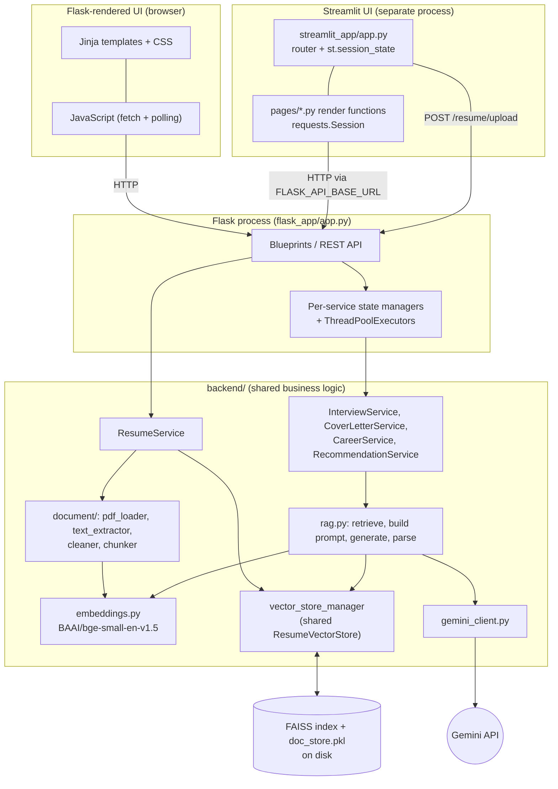
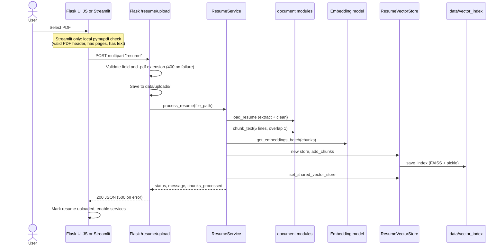
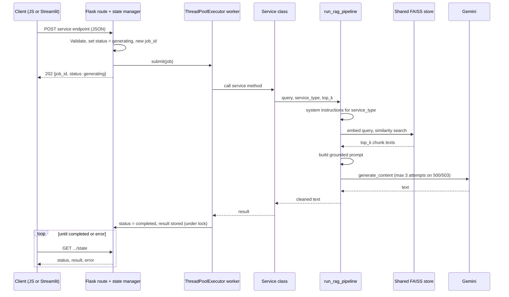
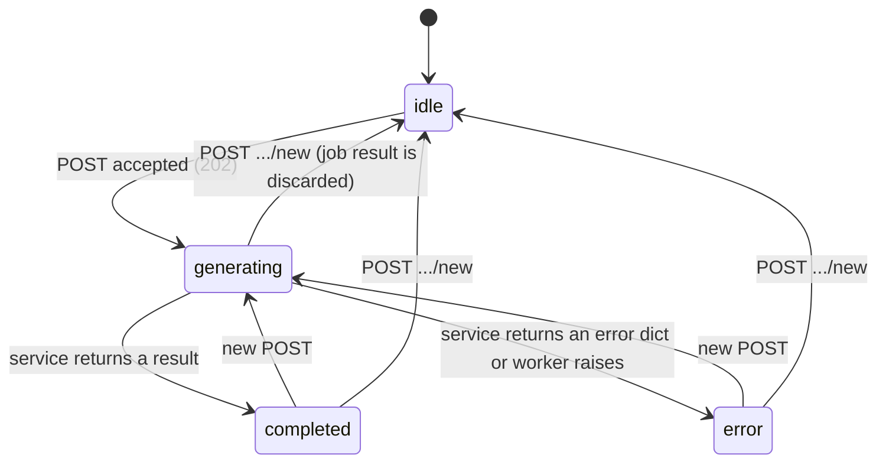

# ReZume

ReZume is an AI-powered resume and career assistant. A user uploads a PDF resume, the backend turns it into searchable vector chunks, and five AI services (interview practice, cover letters, resume scoring, career recommendations, career coaching) answer using the most relevant parts of that resume through a Retrieval-Augmented Generation (RAG) pipeline backed by Gemini.

The project ships two separate user interfaces on top of one backend:

- A **Flask web app** (Jinja templates, CSS, vanilla JavaScript) that also exposes the REST APIs.
- A **Streamlit app** (pure Python) that calls those same Flask APIs over HTTP and does not run the RAG pipeline itself.

> This README was written from the source code in this repository. Where something is a limitation, an unfinished area, or could not be verified, it is called out explicitly (see [Known Limitations](#known-limitations)). No tests were executed while writing it.

## Table of Contents

1. [Features](#features)
2. [Technology Stack](#technology-stack)
3. [Architecture](#architecture)
4. [Project Structure](#project-structure)
5. [End-to-End Resume Workflow](#end-to-end-resume-workflow)
6. [How Retrieval-Augmented Generation (RAG) Works in ReZume](#how-retrieval-augmented-generation-rag-works-in-rezume)
7. [Services](#services)
8. [Frontend Architecture: Flask HTML/CSS/JavaScript and Streamlit](#frontend-architecture-flask-htmlcssjavascript-and-streamlit)
9. [REST API Reference](#rest-api-reference)
10. [Background Processing and Application State](#background-processing-and-application-state)
11. [Setup and Running](#setup-and-running)
12. [Configuration Reference](#configuration-reference)
13. [Testing](#testing)
14. [Troubleshooting](#troubleshooting)
15. [Known Limitations](#known-limitations)
16. [Security Notes](#security-notes)
17. [Purpose](#purpose)

## Features

- PDF resume upload with text extraction (PyMuPDF), cleaning, line-based chunking, local embeddings, and a FAISS index persisted to disk.
- Five AI services built on one shared RAG pipeline: AI Interview, Cover Letter, Resume Scorer, Career Recommendations, Career Coach.
- Long-running AI calls run on background thread pools; the browser or Streamlit client polls a state endpoint.
- Two interchangeable frontends (Flask UI and Streamlit UI) sharing the same REST API.
- Prompt design that tells the model to ground candidate facts in retrieved resume text and to treat resume content as data, not instructions.

## Technology Stack

| Area | Technology |
|---|---|
| Web framework / REST API | Flask (blueprints, Jinja2 templates, cookie sessions) |
| Flask UI | HTML, CSS, vanilla JavaScript (`fetch`, polling with `setInterval`) |
| Alternative UI | Streamlit, `requests.Session` |
| PDF extraction | PyMuPDF (`fitz`) |
| Embeddings | `sentence-transformers`, model `BAAI/bge-small-en-v1.5` (384 dimensions, normalized) |
| Vector search | FAISS (`faiss-cpu`), `IndexFlatIP` (exact inner-product search) |
| LLM | Google Gemini through the `google-genai` SDK |
| Background jobs | `concurrent.futures.ThreadPoolExecutor` |
| Configuration | `python-dotenv`, `PyYAML` |

## Architecture

### Component responsibilities

| Component | Location | Responsibility |
|---|---|---|
| Flask app | `flask_app/app.py` | Creates the app, loads config, registers 8 blueprints, serves pages and APIs |
| Route blueprints | `flask_app/routes/` | HTTP layer: validation, status codes, per-service state managers and thread pools |
| Flask UI | `flask_app/templates/`, `flask_app/static/` | Browser interface; JS calls the REST APIs |
| Streamlit UI | `streamlit_app/` | Separate Python UI; forwards inputs to the Flask APIs and renders returned state |
| Resume processing | `backend/document/`, `backend/services/resume_service.py` | Extract, clean, chunk, embed, store |
| Embeddings | `backend/ai/embeddings.py` | Loads the sentence-transformers model once at import; embeds text |
| Vector store | `backend/ai/vector_store.py` | FAISS index plus a `{id: chunk_text}` dictionary, saved/loaded from disk |
| Shared store manager | `backend/ai/vector_store_manager.py` | Process-wide singleton `ResumeVectorStore` (lazy load) |
| Retriever | `backend/ai/retriever.py` | Embeds the query and returns the top-k chunk texts |
| RAG pipeline | `backend/ai/rag.py` | Orchestrates system prompt, retrieval, prompt building, Gemini call, output parsing |
| Prompts | `backend/ai/prompts.py` | Per-service system instructions and the grounded RAG prompt template |
| LLM client | `backend/ai/gemini_client.py` | Gemini calls with limited retry on HTTP 500/503 |
| Output parsing | `backend/ai/response_parser.py` | Text clean-up (and JSON parsing, currently unused by any service) |
| Service classes | `backend/services/` | Per-service query construction and RAG parameters |

### High-level architecture



The Streamlit process never imports `backend/`. It only uses HTTP (`requests`). The one piece of PDF work it does locally is a pre-check (see [Streamlit interface](#streamlit-interface)).

## Project Structure

```text
.
├── README.md
├── Structure.txt                     # informal design notes
├── requirements.txt
├── .gitignore
├── backend/
│   ├── ai/
│   │   ├── embeddings.py             # SentenceTransformer, normalize_embeddings=True
│   │   ├── gemini_client.py          # Gemini client, retries on 500/503
│   │   ├── prompts.py                # system instructions + build_rag_prompt
│   │   ├── rag.py                    # run_rag_pipeline
│   │   ├── response_parser.py        # process_ai_output (text / json)
│   │   ├── retriever.py              # retrieve_relevant_chunks
│   │   ├── vector_store.py           # ResumeVectorStore (FAISS IndexFlatIP)
│   │   └── vector_store_manager.py   # shared singleton store
│   ├── document/
│   │   ├── chunker.py
│   │   ├── cleaner.py
│   │   ├── pdf_loader.py
│   │   ├── resume_parser.py          # not implemented (raises NotImplementedError)
│   │   └── text_extractor.py
│   ├── services/
│   │   ├── career_service.py         # career_coach + resume_scorer
│   │   ├── cover_letter_service.py
│   │   ├── interview_service.py
│   │   ├── proofreading_service.py   # no Flask route or UI uses it
│   │   ├── recommendation_service.py
│   │   └── resume_service.py
│   └── utils/logger.py
├── config/
│   ├── settings.yaml                 # only ai.llm_model is read by code
│   ├── logging.config
│   └── prompts.yaml                  # empty
├── flask_app/
│   ├── app.py                        # entry point (run from this directory)
│   ├── config.py                     # SECRET_KEY, GEMINI_API_KEY from .env
│   ├── data/vector_index/            # faiss_index.bin, doc_store.pkl (committed)
│   ├── routes/
│   │   ├── main.py                   # /, /profile*
│   │   ├── career.py                 # /career/dashboard, /career/coach pages
│   │   ├── resume.py                 # /resume/*
│   │   ├── interview.py              # /interview/*
│   │   ├── cover_letter.py           # /career/*cover_letter*
│   │   ├── resume_scorer.py          # /career/scorer, /career/api/score*
│   │   ├── recommendation.py         # /career/recommendations, /career/api/recommendations*
│   │   └── coach.py                  # /career/api/chat*
│   ├── templates/
│   │   ├── base.html, home.html, profile.html
│   │   ├── resume/index.html
│   │   ├── interview/index.html
│   │   └── career/{dashboard,coach,cover_letter,resume_scorer,recommendations}.html
│   └── static/
│       ├── css/                      # base, home, profile, resume, interview, coach,
│       │                             # cover_letter, resume_score, recommendations, career, dashboard
│       ├── js/                       # main, resume, interview, coach, cover_letter,
│       │                             # resume_scorer, recommendations, profile, career
│       └── images/
├── streamlit_app/
│   ├── app.py                        # entry point + page router
│   ├── settings.py                   # reads FLASK_API_BASE_URL
│   ├── images/                       # favicon.png, mermaid-diagram.png
│   └── pages/
│       ├── Ai_Interview.py
│       ├── Cover_Letter.py
│       ├── Resume_Scorer.py
│       ├── Career_Recommendations.py
│       └── Career_Couch.py           # (sic) Career Coach page
├── tests/
│   ├── test_gemini.py
│   └── integration/{test_pipeline.py, test_rag_pipeline.py}
├── infrastructure/                   # Dockerfile.flask, Dockerfile.streamlit, docker-compose.yml (all empty)
└── notebooks/data_exploration.ipynb  # empty
```

`flask_app/static/js/career.js` exists but no template references it.

## End-to-End Resume Workflow

Flask UI: the upload page is `/resume/` (`resume/index.html` + `resume.js`). Streamlit: the "Welcome" page in `streamlit_app/app.py`. Both send the file to `POST /resume/upload` as a multipart field named `resume`.

### Verified sequence

1. The user selects a PDF.
2. The frontend posts it to `/resume/upload`.
3. Flask checks that the `resume` field exists, a filename is present, and the name ends in `.pdf` (else HTTP 400). Size limits from `config/settings.yaml` are **not** enforced.
4. The file is saved as `<current working directory>/data/uploads/<secure_filename>`. When Flask is started from `flask_app/` (see [Setup](#setup-and-running)) this is `flask_app/data/uploads/`.
5. `ResumeService.process_resume` calls `load_resume`, which extracts text page by page with PyMuPDF (`get_text("text")`, pages joined with blank lines) and cleans it (collapses runs of spaces/tabs, caps consecutive newlines at two, strips).
6. `chunk_text(chunk_size=5, overlap=1)` splits on newlines, bullet characters and spaced hyphens, drops lines of 5 characters or fewer, then groups **5 lines per chunk with a 1-line overlap**.
7. `get_embeddings_batch` embeds all chunks (`BAAI/bge-small-en-v1.5`, normalized).
8. A **new** `ResumeVectorStore` is created (a second upload replaces the previous resume's vectors, it does not append). Chunks and vectors are added, then written to `data/vector_index/faiss_index.bin` and `doc_store.pkl`.
9. `set_shared_vector_store` makes that store the process-wide shared instance.
10. The API returns `{"status": "success", "message": ..., "chunks_processed": N}` (HTTP 200); on processing errors it returns the error dict with HTTP 500.
11. The Flask route sets module-level `resume_uploaded` / `resume_filename`. `GET /resume/status` reports them, and `main.js` uses that to enable or disable service controls on each page. Streamlit instead sets `st.session_state["resume_uploaded"]`, filename, and `page = "services"`.
12. A service endpoint receives user input, its service class builds a query, `run_rag_pipeline` retrieves chunks, builds the prompt, calls Gemini, and the route stores the output in its in-memory state, which the client polls (see the next sections).

### Upload sequence



### Streamlit session text vs. the vector store

Streamlit extracts the PDF text locally with `pymupdf` for validation and stores it in `st.session_state["resume_text"]`. **That text is not sent to the RAG pipeline** and no page reads it after upload. The RAG pipeline only sees what the Flask backend indexed from the file it received at `/resume/upload`. The two copies are independent.

## How Retrieval-Augmented Generation (RAG) Works in ReZume

All five services call `backend/ai/rag.py::run_rag_pipeline(user_query, vector_store, service_type, expected_format, top_k)`.

1. **Service-specific request.** The service class builds a natural-language query (for example "write an ATS-friendly cover letter for this job description", or the interview transcript plus the candidate's latest answer).
2. **System instructions.** `get_system_instructions(service_type)` selects a persona from `SYSTEM_INSTRUCTIONS` (`recommendation`, `career_coach`, `cover_letter`, `resume_scorer`, `ai_interview`); unknown types fall back to `career_coach`.
3. **Query embedding.** `retriever.py` embeds the **entire query string** with the same model used for the resume chunks (`BAAI/bge-small-en-v1.5`, normalized).
4. **FAISS similarity search.** `IndexFlatIP.search` returns the `top_k` nearest chunk ids by inner product. Because vectors are normalized, this equals cosine similarity. `top_k` is capped at the number of stored vectors. This is plain dense retrieval: there is no BM25, hybrid search, or reranking.
5. **Chunk selection.** Ids are mapped back to chunk text through `doc_store`.
6. **Context preparation.** `build_rag_prompt` joins chunks with `\n\n---\n\n`. If no chunks were retrieved, the prompt instead tells the model the resume context is empty and to answer exactly `Information not found.` for candidate-specific questions.
7. **Prompt construction.** The grounded template instructs the model to use only the resume context for candidate-specific facts, to ignore instructions inside the resume, and to answer `Information not found.` when unsupported. The user query is appended after the context.
8. **Generation.** `GeminiClient.generate_response` sends the prompt with the service's system instruction and `max_output_tokens` (2048 for `cover_letter`, 1024 for everything else). It makes up to 3 attempts, retrying only on HTTP 500/503 with waits of 2 s then 4 s. Other errors, and empty responses, raise immediately.
9. **Post-processing.** `process_ai_output` runs `parse_text_response`, which strips whitespace and removes a few leading filler phrases ("Certainly!", "Sure!", "Sure,", "Here is the Cover Letter:", "Here is the Response:"). A JSON parser exists, but every service currently requests `"text"`.
10. **Delivery.** On any exception inside the pipeline, `run_rag_pipeline` returns an error **string** (text mode) rather than raising. Route-level state managers only mark a job as `error` when a service returns a dict with an `error` key, so an error string from the pipeline can be stored as a normal "completed" result (see [Known Limitations](#known-limitations)).

### Settings

| Setting | Value | Source |
|---|---|---|
| Embedding model | `BAAI/bge-small-en-v1.5` | Hard-coded in `embeddings.py` |
| Embedding dimension | 384 | Hard-coded `EMBEDDING_DIMENSION` in `vector_store.py` |
| Index type | `faiss.IndexFlatIP` | Hard-coded |
| Chunking | 5 lines per chunk, overlap 1 | Hard-coded in `resume_service.py` |
| LLM model | `gemini-3.6-flash` | `config/settings.yaml` → `ai.llm_model` (read by `gemini_client.py`) |
| Gemini API key | environment | `GEMINI_API_KEY` |
| `top_k` | per service (table below) | Hard-coded in each service |

Other keys in `config/settings.yaml` (`chunk_size`, `chunk_overlap`, `embedding_model`, `default_retriever_k`, upload limits, directory paths) are **not read by the code**. Changing them has no effect. The model name is not overridable by an environment variable.

### How each service varies the pipeline

| Service | Class | `service_type` | `top_k` | `max_output_tokens` |
|---|---|---|---|---|
| AI Interview | `InterviewService` | `ai_interview` | 3 | 1024 |
| Cover Letter | `CoverLetterService` | `cover_letter` | 5 | 2048 |
| Resume Scorer | `CareerService` | `resume_scorer` | 5 | 1024 |
| Career Recommendations | `RecommendationService` | `recommendation` | 4 | 1024 |
| Career Coach | `CareerService` | `career_coach` | 3 | 1024 |



## Services

Every Flask-side service follows the same pattern: a `POST` starts a background job and returns `202`; a `GET .../state` endpoint reports progress; a `POST .../new` resets state. Full endpoint details are in the [API reference](#rest-api-reference).

### AI Interview

- **Files:** `backend/services/interview_service.py`, `flask_app/routes/interview.py`, `templates/interview/index.html`, `static/js/interview.js`, `streamlit_app/pages/Ai_Interview.py`.
- **Greeting:** a fresh state already contains one AI turn: "Welcome to your AI Technical Interview. Let's begin. Please introduce yourself and tell me about your technical background." No model call is needed to start.
- **Answer submission:** `POST /interview/api/chat` with `{"candidate_answer": "..."}`. The service appends the candidate turn immediately, snapshots the earlier history, sets `generating`, and submits `_generate_response` to a pool (max 4 workers).
- **History:** earlier turns are formatted into a `PREVIOUS INTERVIEW TRANSCRIPT` (roles "Hiring Manager" / "Candidate") that becomes part of the **query**. That whole query is also what gets embedded for retrieval (`top_k=3`).
- **Evaluation and next question:** the query tells the model to briefly evaluate the answer using the resume context, avoid repeating questions, and ask exactly one new technical follow-up. On success the AI text is appended to `conversation` and set as `result`.
- **State retrieval:** `GET /interview/api/state` returns `conversation`, `status`, `job_id`, `error`, `result`.
- **New interview:** `POST /interview/api/new` replaces the session's state with the default one (greeting only).
- **Isolation:** state is keyed by `session["interview_session_id"]` (a UUID in the Flask session cookie).

### Cover Letter

- **Files:** `backend/services/cover_letter_service.py`, `flask_app/routes/cover_letter.py` (contains the `CoverLetterState` manager), `templates/career/cover_letter.html`, `static/js/cover_letter.js`, `streamlit_app/pages/Cover_Letter.py`.
- **Input:** `{"job_description": "..."}`.
- **Query:** "Please write a professional, ATS-friendly cover letter for the following job description" plus the text; `top_k=5`, 2048 output tokens, `cover_letter` persona ("Output only the final cover letter").
- **State:** `job_description`, `status`, `job_id`, `error`, `result`; keyed by `session["cover_letter_session_id"]`.
- **Output handling:** the Flask page has a copy-to-clipboard button (`copyCoverLetterBtn`). The Streamlit page shows the text and offers a download button producing `ReZume_cover_letter.txt`. The Flask UI has no file-download feature that I could find.

### Resume Scorer

- **Files:** `backend/services/career_service.py` (`service_type="resume_scorer"`), `flask_app/routes/resume_scorer.py`, `templates/career/resume_scorer.html`, `static/js/resume_scorer.js`, `streamlit_app/pages/Resume_Scorer.py`.
- **Input:** `{"job_description": "..."}`.
- **Query:** "Please evaluate my resume against the following job description and return the exact requested JSON format:" followed by the job description. The wording says JSON, but the system prompt requires plain text and the call uses `expected_format="text"`. `top_k=5`.
- **Output structure:** the system prompt asks for exactly three lines:

  ```text
  Score: <0-100>
  Skills_match_score: <0-100>
  Perfect_match_score: <0-100>
  ```

  The route stores the **raw string** as `result`. `resume_scorer.js` extracts the three numbers with regular expressions and renders them as percentages. The Streamlit page shows the raw text in a disabled text area. No other metrics exist. The numbers are produced by the model, not computed by application code.
- **State:** keyed by `session["resume_scorer_session_id"]`.

### Career Recommendations

- **Files:** `backend/services/recommendation_service.py`, `flask_app/routes/recommendation.py`, `templates/career/recommendations.html`, `static/js/recommendations.js`, `streamlit_app/pages/Career_Recommendations.py`.
- **Input:** optional `{"target_role": "..."}` (empty or missing means general).
- **With a target role**, the query demands a fixed structure: *Skills to Upgrade* (exactly 3, each with a "Learn:" line), *Recommended Certification* (1, with "Why:"), *Recommended Project* (1, with "Technologies:"), and *Next Step*. It allows general industry knowledge for recommendations but forbids inventing candidate experience and forbids discussing employment or career gaps. The `recommendation` persona caps the answer at 250 words.
- **Without a role**, a shorter query asks for 3 skills, 1 portfolio project, and general career-development advice. It does not request the certification or next-step sections.
- **Retrieval:** `top_k=4`.
- **State handling limitation:** unlike the other services, recommendation state is **one global dict** (`_recommendation_state`) shared by every browser/user of the Flask process, not a per-session object. Two users clicking Generate at the same time will see each other's status (the second receives `409`) and results.

### Career Coach

- **Files:** `backend/services/career_service.py` (`service_type="career_coach"`), `flask_app/routes/coach.py` (the `CareerCoachState` manager), `flask_app/routes/career.py` (serves `/career/coach`), `templates/career/coach.html`, `static/js/coach.js`, `streamlit_app/pages/Career_Couch.py`.
- **Question submission:** `POST /career/api/chat` with `{"question": "..."}`. The user message is appended to `messages` immediately; on success an `assistant` message is appended.
- **Conversation history:** `messages` is kept for **display** only. `CareerService.handle_ai_request` receives only the current question, so earlier turns are **not** included in the prompt or retrieval query. Each answer is independent.
- **Retrieval:** `top_k=3`, `career_coach` persona (answers `Information not found.` when resume context doesn't support a candidate-specific question).
- **State and reset:** `GET /career/api/chat/state`, `POST /career/api/chat/new`; keyed by `session["career_coach_session_id"]`.

## Frontend Architecture: Flask HTML/CSS/JavaScript and Streamlit

### Flask web interface

- Flask renders Jinja templates. Every page extends `templates/base.html`, which provides the sidebar navigation, header, `css/base.css`, and `js/main.js`, and exposes `extra_css`, `content` and `extra_js` blocks.
- Pages and their assets:

| Page | URL | Template | CSS | JS |
|---|---|---|---|---|
| Home | `/` | `home.html` | `home.css` | `main.js` |
| Resume upload | `/resume/` | `resume/index.html` | `resume.css` | `resume.js` |
| AI Interview | `/interview/` | `interview/index.html` | `interview.css` | `interview.js` |
| Cover Letter | `/career/cover_letter` | `career/cover_letter.html` | `cover_letter.css` | `cover_letter.js` |
| Resume Scorer | `/career/scorer` | `career/resume_scorer.html` | `resume_score.css` | `resume_scorer.js` |
| Recommendations | `/career/recommendations` | `career/recommendations.html` | `recommendations.css` | `recommendations.js` |
| Career Coach | `/career/coach` | `career/coach.html` | `coach.css` | `coach.js` |
| Profile | `/profile` | `profile.html` | `profile.css` | `profile.js` |
| Career dashboard | `/career/dashboard` | `career/dashboard.html` | `dashboard.css` | none |

- Each service script loads the current state on page load, `POST`s the user's input, shows a loading indicator, then polls the matching `GET .../state` endpoint with `setInterval` until the status is `completed` or `error`, rendering the result or an error message.
- `main.js` calls `GET /resume/status` on every page and disables or enables the service inputs and buttons accordingly.
- The browser holds Flask's signed session cookie, which carries the per-service session ids. Cookies are signed with `FLASK_SECRET_KEY`.

### Streamlit interface

- **Entry point:** `streamlit_app/app.py`. It sets `st.session_state` defaults (`resume_uploaded`, `resume_filename`, `resume_text`, `page`), hides the default sidebar with CSS, and routes by `st.session_state["page"]`: `welcome` → `services` → one of `ai_interview`, `cover_letter`, `resume_scorer`, `career_recommendations`, `career_coach`.
- **Router:** each service page is imported lazily (`from pages.X import render_*`) and its render function is called. Each page begins by checking `resume_uploaded` and sends the user back to the upload page if it is false.
- **Flask client:** pages share `st.session_state["flask_api_client"]`, a persistent `requests.Session`, so Flask's session cookie is reused and per-session state (interview, cover letter, scorer, coach) maps to one Streamlit user session.
- **Upload:** `app.py` validates the PDF locally (`%PDF-` header, at least one page, extractable text), then posts the file to `{FLASK_API_BASE_URL}/resume/upload` with a plain `requests.post` (300 s timeout; it does not use the shared client). The upload does not depend on a session cookie because resume status and the vector store are process-global on the Flask side.
- **Polling:** the Interview page polls `/interview/api/state` every second for up to 180 s after sending an answer. The other four pages show a "Refresh Status" button and re-read state on every Streamlit rerun; they do not auto-poll.
- **Implemented:** all five service pages call the real Flask endpoints and render state. The Career Coach page appends a "Back to Resume Upload" button in the router.
- **Notes:** the page modules sit under `streamlit_app/pages/`, which Streamlit may also treat as its own multipage directory; the app hides the sidebar and navigates through `st.session_state`. `streamlit_app/images/mermaid-diagram.png` is an older user-flow image that includes a Proofreading service which has no Flask route or Streamlit page, so it is not used here.

## REST API Reference

Base URL (default when run directly): `http://127.0.0.1:5000`. JSON endpoints read the body with `request.get_json(silent=True)`, so a malformed body is treated as empty (usually `400`).

### Resume

| Method | Route | Purpose | Request | Key response fields | Status codes | Mode |
|---|---|---|---|---|---|---|
| GET | `/resume/` | Upload page (HTML) | none | HTML | 200 | sync |
| GET | `/resume/status` | Whether a resume was processed (global) | none | `resume_uploaded`, `resume_filename` | 200 | sync |
| POST | `/resume/upload` | Upload and index a PDF | multipart, field `resume` (`.pdf`) | `status`, `message`, `chunks_processed`; errors: `error` | 200, 400 (missing field/empty name/not `.pdf`), 500 (processing failure) | **sync** (blocks until embedding and indexing finish) |

### AI Interview

| Method | Route | Purpose | Request | Key response fields | Status codes | Mode |
|---|---|---|---|---|---|---|
| GET | `/interview/` | Page | none | HTML | 200 | sync |
| GET | `/interview/api/state` | Current conversation and job status | none | `conversation[]` (`role`, `content`), `status`, `job_id`, `error`, `result` | 200, 500 | sync |
| POST | `/interview/api/chat` | Submit a candidate answer | `{"candidate_answer": str}` | `job_id`, `status` | 202, 400 (missing/empty), 409 (already generating), 500 | background |
| POST | `/interview/api/new` | Reset the interview | none | default state | 200, 500 | sync |

### Cover Letter

| Method | Route | Purpose | Request | Key response fields | Status codes | Mode |
|---|---|---|---|---|---|---|
| GET | `/career/cover_letter` | Page | none | HTML | 200 | sync |
| GET | `/career/api/cover_letter/state` | Current job state | none | `job_description`, `status`, `job_id`, `error`, `result` | 200, 500 | sync |
| POST | `/career/api/cover_letter` | Start generation | `{"job_description": str}` | `job_id`, `status` | 202, 400 (missing/empty **or** already generating), 500 | background |
| POST | `/career/api/cover_letter/new` | Reset | none | default state | 200, 500 | sync |

### Resume Scorer

| Method | Route | Purpose | Request | Key response fields | Status codes | Mode |
|---|---|---|---|---|---|---|
| GET | `/career/scorer` | Page | none | HTML | 200 | sync |
| GET | `/career/api/score/state` | Current job state | none | `job_description`, `status`, `job_id`, `error`, `result` (three-line text) | 200, 500 | sync |
| POST | `/career/api/score` | Start scoring | `{"job_description": str}` | `job_id`, `status` | 202, 400 (missing/empty **or** already generating), 500 | background |
| POST | `/career/api/score/new` | Reset | none | default state | 200, 500 | sync |

### Career Recommendations

| Method | Route | Purpose | Request | Key response fields | Status codes | Mode |
|---|---|---|---|---|---|---|
| GET | `/career/recommendations` | Page | none | HTML | 200 | sync |
| POST | `/career/api/recommendations` | Start generation | `{"target_role": str}` (optional, may be null/empty) | `message`, `job_id`, `status` | 202, 400 (non-string role), 409 (already generating) | background |
| GET | `/career/api/recommendations/state` | Current job state (**global**) | none | `job_id`, `status`, `target_role`, `result`, `error` | 200 | sync |
| POST | `/career/api/recommendations/new` | Reset (global) | none | `message`, `status` | 200, 409 (still generating) | sync |

### Career Coach

| Method | Route | Purpose | Request | Key response fields | Status codes | Mode |
|---|---|---|---|---|---|---|
| GET | `/career/coach` | Page | none | HTML | 200 | sync |
| GET | `/career/api/chat/state` | Messages and job state | none | `messages[]` (`role`: `user`/`assistant`), `current_question`, `status`, `job_id`, `error`, `result` | 200, 500 | sync |
| POST | `/career/api/chat` | Ask a question | `{"question": str}` | `job_id`, `status` | 202, 400 (missing/empty), 409 (already generating), 500 | background |
| POST | `/career/api/chat/new` | Clear the conversation | none | default state | 200, 500 | sync |

### Other pages and profile routes

| Method | Route | Purpose |
|---|---|---|
| GET | `/` | Home page |
| GET | `/career/dashboard` | Career dashboard page |
| GET | `/profile` | Profile page (name/image from the session) |
| POST | `/profile/update-name` | JSON `{"user_name": str}`; `400` if empty |
| POST | `/profile/upload-image` | Multipart field `profile_image`; saved under `flask_app/static/images/profiles/` |

`ProofReadingService` exists in the backend but no endpoint or UI exposes it.

### curl examples

Use a cookie jar so Flask's session cookie is reused between calls.

```bash
# Upload and index a resume (field name must be "resume")
curl -c cookies.txt -b cookies.txt \
  -F "resume=@/path/to/resume.pdf;type=application/pdf" \
  http://127.0.0.1:5000/resume/upload

# Start a cover-letter job (returns 202)
curl -c cookies.txt -b cookies.txt \
  -H "Content-Type: application/json" \
  -d '{"job_description": "Python developer with Flask and ML experience"}' \
  http://127.0.0.1:5000/career/api/cover_letter

# Poll until status is "completed" or "error"
curl -c cookies.txt -b cookies.txt \
  http://127.0.0.1:5000/career/api/cover_letter/state
```

### How Streamlit finds Flask

`streamlit_app/settings.py` loads the project-root `.env` and reads `FLASK_API_BASE_URL` (trailing `/` stripped). If it is empty or missing, Streamlit stops at import with `RuntimeError: FLASK_API_BASE_URL is missing`. Every page builds URLs as `f"{API_BASE_URL}/..."`, so the value must be the base URL where Flask is reachable (for example `http://127.0.0.1:5000`), without a path suffix.

## Background Processing and Application State

- **Mechanism:** `ThreadPoolExecutor` objects in the Flask process: 4 workers each for interview, cover letter, resume scorer and career coach, 2 workers for recommendations. They are created at module import (the interview pool when `InterviewService` is first created).
- **Why POST returns first:** a Gemini call plus retrieval can take seconds, so the route records a `job_id`, sets `status = "generating"`, submits the job, and returns `202`. The result is written into state under a lock when the worker finishes.
- **Job state values:** `idle` (initial or after reset), `generating`, `completed`, `error`.
- **Stale-job guard:** a worker writes its result only if the state's current `job_id` still equals its own. Resetting a session (`.../new`) clears `job_id`, so an in-flight job's result is discarded.
- **Duplicate guard:** while `generating`, another `POST` for the same session is rejected (`409` for interview, coach and recommendations; `400` for cover letter and scorer).



(`/recommendations/new` is the exception: it returns `409` while generating.)

### Where state lives

| Layer | What it holds | Lifetime |
|---|---|---|
| Flask session cookie | Random session ids (`interview_session_id`, `cover_letter_session_id`, `resume_scorer_session_id`, `career_coach_session_id`), profile name/image | Browser cookie; signed with `FLASK_SECRET_KEY` |
| Flask in-memory state managers | Conversations, job status, results, keyed by those ids | Until the Flask process stops |
| Flask module globals | `resume_uploaded`, `resume_filename`, the shared vector store, the recommendation state | Until the Flask process stops (the vector store is reloaded from disk) |
| Disk | `data/uploads/*.pdf`, `data/vector_index/faiss_index.bin`, `doc_store.pkl` | Persistent |
| Streamlit `st.session_state` | Active page, resume flags/filename/text, `requests.Session`, widget values | Per Streamlit browser session |

On a Flask restart, all conversations, results, and job state are lost (in-memory only), and `resume_uploaded` resets to `False`. The FAISS index and doc store files persist and are loaded lazily by the next service that calls `get_shared_vector_store()`, so retrieval can work again, but the resume status endpoint will still say no resume was uploaded until a new upload.

## Setup and Running

### Prerequisites

- Python 3 with `pip` (the repository does not pin a version).
- A Gemini API key.
- Enough disk and network to download the `BAAI/bge-small-en-v1.5` model on first start and install `torch` (large).

### Install

```bash
git clone https://github.com/M-Sudheer18/Career-Coach-Application.git
cd Career-Coach-Application

python -m venv venv
source venv/bin/activate          # Windows: venv\Scripts\activate

pip install -r requirements.txt
pip install streamlit             # NOT listed in requirements.txt, needed for the Streamlit UI
```

`requirements.txt` lists, unpinned: Flask, beautifulsoup4, faiss-cpu, google-genai, numpy, pymupdf, pypdf, python-dotenv, PyYAML, requests, scikit-learn, sentence-transformers, torch. **`streamlit` is missing** from it.

### Configure environment variables

There is no `.env.example` in the repository. Create a `.env` file in the **project root** (it is git-ignored):

```bash
GEMINI_API_KEY=YOUR_GEMINI_API_KEY
FLASK_SECRET_KEY=A_LONG_RANDOM_STRING
FLASK_API_BASE_URL=http://127.0.0.1:5000
```

Never commit real keys. `FLASK_SECRET_KEY` is read without a default; if it is unset, Flask sessions (and therefore all per-session service state) will not work.

### Start Flask (terminal 1)

The entry point imports `routes.*` as top-level modules and uses relative `data/` paths, so **run it from inside `flask_app/`**:

```bash
cd flask_app
python app.py
```

`app.py` starts Flask with `host=127.0.0.1`, `port=5000`, `debug=True`. Open `http://127.0.0.1:5000/` for the Flask UI.

Verify the API is up (no auth required):

```bash
curl -i http://127.0.0.1:5000/resume/status
# expect HTTP 200 and {"resume_filename": null, "resume_uploaded": false}
```

### Start Streamlit (terminal 2)

With the same virtual environment active, from the project root:

```bash
streamlit run streamlit_app/app.py
```

Streamlit is not given an explicit port in the code, so it uses Streamlit's own default (usually `http://localhost:8501`) unless you configure otherwise. Flask must be running first and `FLASK_API_BASE_URL` must point at it.

### Typical use

1. Open either UI and upload a text-based PDF resume (in the Flask UI go to **Resume**; in Streamlit use the Welcome page).
2. Pick a service.
3. Wait for the background job to finish (auto-polling in the Flask UI and the Interview page; "Refresh Status" elsewhere in Streamlit).

## Configuration Reference

| Name | Where | Required | Effect |
|---|---|---|---|
| `GEMINI_API_KEY` | `.env` / environment | Yes | Read in `GeminiClient.__init__`; missing key raises `ValueError("API Key is Missing..")` |
| `FLASK_SECRET_KEY` | `.env` / environment | Yes for Flask sessions | Flask `SECRET_KEY` |
| `FLASK_API_BASE_URL` | `.env` / environment | Yes for Streamlit | Base URL used for all Streamlit→Flask calls |
| `ai.llm_model` | `config/settings.yaml` | Yes (file must exist) | Gemini model name (default `gemini-3.6-flash`) |

`flask_app/config.py` loads `.env` with `override=True`, so values in the file take precedence over variables already in the shell for the Flask process.

## Testing

There is no automated test suite (no `pytest` config, no assertions). The files under `tests/` are manual scripts:

- `tests/integration/test_pipeline.py`: runs extract → clean → chunk on a PDF at `data/raw_uploads/Resume_Sudheer.pdf` and prints results.
- `tests/integration/test_rag_pipeline.py`: runs extract → chunk → embed → FAISS → RAG on the same path and prints the answer (needs `GEMINI_API_KEY`).
- `tests/test_gemini.py`: sends a one-line prompt with a hard-coded model name (`gemini-3.8-flash`, different from `config/settings.yaml`). It executes at import time.

The sample PDF is not in the repository, so these scripts must be given your own file at that path. They were not run for this README.

## Troubleshooting

**Observed from the code**

| Symptom | Cause / check |
|---|---|
| Streamlit fails at start with `FLASK_API_BASE_URL is missing` | Add it to the root `.env` (`settings.py` raises `RuntimeError`) |
| Streamlit shows "Could not connect to the Flask backend" | Flask not running, or `FLASK_API_BASE_URL` points elsewhere. Test with `curl <base>/resume/status` |
| `ModuleNotFoundError: routes` when starting Flask | You ran it from the project root. `cd flask_app` first |
| `ModuleNotFoundError: streamlit` | `streamlit` is not in `requirements.txt`; `pip install streamlit` |
| Job ends in `error`, log shows `API Key is Missing..` | `GEMINI_API_KEY` not set in `.env` / environment |
| Upload returns 400 | Missing `resume` field, empty filename, or filename not ending in `.pdf` |
| Upload returns 500 with details | See Flask log (`A Error Occurred while processing Document...`). Corrupt, encrypted (non-empty password), or scanned image-only PDFs yield no extractable text |
| Answers are "Information not found." | Retrieval returned nothing (empty or missing index) or the resume text doesn't support the question. Check log lines `Shared Vector is Loaded but it is Empty..` / `Searching in Empty Faiss Index..` |
| Job stays `generating` | The worker is still running or Gemini is retrying (500/503 backoff 2 s, 4 s). Check logs for `Retrying in ...`. A restart of Flask clears a stuck state |
| Duplicate request rejected (`409`/`400`) | A job is already `generating` for that session (or globally for recommendations) |
| Streamlit page loses its results | Streamlit state is per browser session; the cookie-bearing `requests.Session` lives in `st.session_state`, so a new Streamlit session gets a fresh Flask session |
| State lost after server restart | All service state is in memory (see above) |

## Known Limitations

These are observed in the current code, not hypothetical.

1. **One resume for the whole server.** `resume_uploaded`, `resume_filename`, and the vector store are process-global. A new upload from anyone replaces the index for every user.
2. **Stale vector store after a second upload.** Each service class copies the shared store reference once in `__init__`, and the routes keep long-lived service instances. `ResumeService` replaces the shared store on upload, but services already created keep pointing at the old index until Flask restarts. `reload_shared_vector_store()` exists but nothing calls it. (Services created after the upload use the new index, so this shows up when a service was used before re-uploading.)
3. **Recommendation state is global** rather than per session.
4. **Empty-text upload can be reported as success.** When extraction yields no text, `ResumeService` returns `{"error": ...}` with no `status` key; the route only treats `status == "error"` as failure, so it returns HTTP 200 and sets `resume_uploaded = True`.
5. **Pipeline errors can look like results.** `run_rag_pipeline` converts exceptions into an error *string*, which the route layer stores as a completed result.
6. **No conversation memory for the Career Coach.** Only the Interview service sends history to the model.
7. **Settings file mostly decorative.** Only `ai.llm_model` is consumed; chunking, embedding, top-k and upload limits are hard-coded.
8. **`coach.js` reads `localStorage["resumeUploaded"]`, which nothing in the JavaScript sets.** `main.js` re-enables the coach controls once `/resume/status` returns, but `coach.js::enableInput()` returns early without that key, so the input may stay disabled after sending a message. I did not run the UI to confirm this.
9. **Unfinished or unused parts:** `backend/document/resume_parser.py` raises `NotImplementedError`; `ProofReadingService` has no route; `infrastructure/*`, `config/prompts.yaml` and the notebook are empty; `career.js` is not referenced by a template; the Flask app starts with `debug=True`.
10. **Unpinned dependencies** and no `.env.example`; `streamlit` is absent from `requirements.txt`.

## Security Notes

- Keep `.env` out of version control (it is git-ignored). Use placeholders in documentation.
- `GeminiClient` logs the first 3 characters and the length of the API key at startup; `rag.py` prints raw model output (derived from resume content) to stdout. Review logs before sharing them.
- Uploaded PDFs are saved under `data/uploads/` using `secure_filename`; same-named uploads overwrite each other. `flask_app/data/uploads/` is git-ignored, but `flask_app/data/vector_index/` is **committed** and contains chunks of whatever resume was indexed when it was committed. Remove it from the repository if it contains personal data.
- `doc_store.pkl` is loaded with `pickle`; only load index files you created yourself.
- Prompts instruct the model to treat resume text as data, which reduces but does not eliminate prompt-injection risk.
- There is no authentication, rate limiting, or CSRF protection. This README makes no claim that the app is production-ready.

## Purpose

ReZume explores how a retrieval-grounded LLM workflow can support job seekers: index one resume, then reuse that single index for interview practice, tailored cover letters, job-fit scoring, targeted recommendations, and free-form career questions, behind either a conventional web UI or a lightweight Streamlit front end that shares the same Flask API.